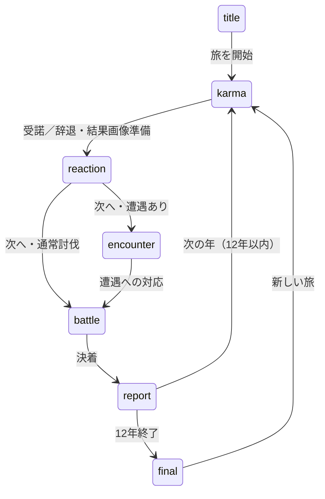

# カルマクエスト — 実装設計書

初版確認日: 2026-10-19。実装基準: `c975eab`（PR #347までを含む作業ツリー。公開状態ではない）。
更新時は変更箇所と [変更記録](../../updates) を同じPRで更新する。運用は [文書更新手順](../../documentation-workflow.md)。
対になる文書: [仕様書](spec.md)。

## 起動と責務
[main.ts](../../../games/karma-quest/src/main.ts) は presentation → conceptArt → mobileLayout → kingdomBackground の順に既存Sceneへ表示を組み込む。順序変更は画面全体への影響を確認する。
[GameScene](../../../games/karma-quest/src/scenes/GameScene.ts) が進行、選択履歴、戦闘・報告を所有する。[conceptArt](../../../games/karma-quest/src/conceptArt.ts) が王都・リーグ・レイド・年代記の造形を担当する。
純粋ロジックは [karma](../../../games/karma-quest/src/logic/karma.ts)、[report](../../../games/karma-quest/src/logic/report.ts)、[league](../../../games/karma-quest/src/logic/league.ts)、[raid](../../../games/karma-quest/src/logic/raid.ts) に分離する。

## 状態と非同期処理

非同期の準備・transition中は入力の二重確定を防ぐ。図は操作上の遷移であり、Scene内部の一時状態をすべて描いたものではない。
画面は進行状態から描画し、縦横の情報表示は共有状態を参照する。表示側に報酬確定を重複実装しない。
[outcomeLoader](../../../games/karma-quest/src/outcomeLoader.ts) と [outcomeArt](../../../games/karma-quest/src/outcomeArt.ts) で結果画像を遅延読込する。初期ロードへ結果画像全件を戻さない。
画像準備中・失敗・再試行と、ページ停止／復帰時の重複選択をE2Eで検査する。
[CrazyGames初期化](../../../games/karma-quest/src/platform/crazygames.ts) は8秒の待機上限を持つ。タイムアウト後の遅延完了で二重開始しない。

## 永続化境界
[progress.ts](../../../games/karma-quest/src/logic/progress.ts): karma_quest_best_stage_v1、karma_quest_total_eval_v1（数値文字列）。
raid.ts: karma_quest_solo_raid_v1（level / hp / maxHp / defeatsのJSON）。maxHpはレベルから再導出する。
loadRaidはレベルを検証してからHPを復元する。不正なレベルの場合はレコード全体をnewRaid()へ戻し、そのHP=0をLv.1の撃破状態へ転用しない。正常なレベルの途中HP・撃破済み状態は維持し、読み込みだけでは保存を書き換えない。
[scoreDisplay](../../../games/karma-quest/src/logic/scoreDisplay.ts) は表示専用。元の数値を短縮文字列で上書きしない。
buildRaidModalは魔王情報、HP、攻撃予測、報酬CTA、操作結果の数値をscoreDisplayで整形する。raidPanel.lastActionは表示用文字列のみ保持し、レイド状態と評価の保存は整形前の値を使用する。大きな保存値で縦横の文字境界・受取後の正確な保存値をE2Eで検査する。
ストレージ利用禁止・容量不足を全面的に吸収する設計ではない。キー変更は移行・復旧方針を仕様書と変更記録に書く。
[soundPreference](../../../games/karma-quest/src/logic/soundPreference.ts) は既存キーkarma_quest_sound_v1の読み書き例外だけを吸収する。読み込み失敗はON、書き込みは成功可否を返す。GameSceneのsoundOnは保存とは独立して更新し、アイコン更新と切り替えを継続する。進行・レイドなど他キーの保存例外はこの責務に含めない。

## 描画・検証
縦ホームnavの現在タブ面はCanvasの場合にfillStyle(0x254b65,0.82)を設定してから既存矩形を描画する。WebGLは従来のグラデーションを使い、選択下線と入力Zoneは変更しない。
buildReactionはCanvasで年表示背面の上部33pxを濃紺alpha 0.94で塗り、見出し面に通常fillStyleの明るい金色を指定する。WebGLは既存グラデーションを維持する。WebKit E2Eで縦横の見出し面の画素と次場面への遷移を検査する。
PlaywrightのbaseURL・起動確認URL・Vite待受は127.0.0.1とKARMA_E2E_PORT（既定15177）で統一する。localhostのアドレス選択に依存させず、--strictPortで使用中ポートからの自動移動を防ぐ。KARMA_REUSE_SERVER=1を使う場合も同じIPv4待受とポートのサーバーを用意する。これはE2E用の接続契約であり、配信設定や保存キーは変更しない。
replayPromptはja/enに加えてshortJaを返し、日本語の横年代記のみshortJaを使う。landscape-replay-hintは中心(591,329)、20px、折返し幅338px。4種類の文言が前の記録の下端314より下、羊皮紙下端344より上に収まることをE2E検査する。
buildFinalのcityShadeはCanvas rendererの場合だけ(34,473)から382×47pxを濃紺・alpha 0.88で塗る。グラデーションが無視されるCanvasでも街名に下地を確保し、WebGLの既存グラデーションは維持する。Windows WebKitの年代記画像基準は実画像・差分の確認後に更新する。
buildFinalのjourneyLabelはrefreshChronicleでjourneyPending/journeyErrorを参照し、横画面と同じ文言・setBusyを使う。年代記の縦横CTAはlockAfterAction=falseとし、280msの固定ロックを重ねない。再入防止はstartRunラッパーのjourneyPendingガードが担う。
refreshReportPreviewはstage >= TOTAL_STAGESをdeityWishのfinalYearへ渡す。年の判定はGameSceneに置き、表示側に12年の定数を複製しない。縦横とも同じプレビューを表示し、i18nで日本語・英語の最終案内を管理する。
縦横のreport-yearはrefreshJourneyでGameScene.stageを参照して更新する。独立した年カウンターや保存キーは追加しない。1年目と12年目で回転後の文言と見出し領域内の文字境界をE2E検査する。
横討伐のcheerCountの背面へ既存hudPlateを追加する。中心(591,314)、374×48設計px、結果カード下端278から12px、CTA上端356まで18pxの間隔を取る。Canvasでも通常fillStyleの濃色下地を持ち、新規画像は追加しない。
縦横JourneyのcheerLabelはcurrentBattleResultから文言とsetBusyを同期する。親Containerのalphaを下げず、共通CTAの暗い面と入力無効化を利用する。戦闘時計・報告への遷移・声援の計算はGameSceneに維持する。
縦報告のpreviewはGameScene.reportPreview.textの最初の句点の後に改行を加える。表示層だけで文の区切りを整え、横画面と計算元の文字列は維持する。報告の画像比較では選択案内・CTA・評価と説明の文言も検査し、画素許容差による文字差分の見逃しを防ぐ。
reportSubmitting中は縦横の記録Zoneと横の神様Zoneのinput.enabledをfalseにし、縦の神様CTAはsetBusyで無効化する。状態解除後のrefreshJourneyで復帰する。選択枠の描画キャッシュより前に入力可否を更新し、枠の再描画が不要な場合も入力状態を同期する。
GameScene.reportSubmittingは報告確定から次年遷移までの表示用状態。評価確定後にtrue、500ms後のnextStage直前とScene作成時にfalseへ戻す。日本語の縦横Journeyはこの間もreportを表示し、CTAを無効化する。入力の確定可否は既存phaseガードで管理し、評価を表示側で再加算しない。
報告CTAの無効化は親Containerのalphaを下げず、共通buttonのsetBusyを利用する。文字を不透明に保ち、Graphicsの暗い面とZoneの入力無効化を同期する。選択件数が0から変化した時に通常表示へ戻す。
最近の入力所有者・中断・音設定保存失敗・報告UI・レイド復旧等の回帰テストは@webkit-regressionタグでWebKit CIの対象にする。従来のスモーク対象も維持し、追加時はタグ付き一覧とCI同等の抽出実行を確認する。
縦横の報告記録のGraphicsはrenderedSelectionを保持し、初回と選択状態の変更時だけ背景・枠を再構築する。行の可視状態と本文は毎回確認し、同じ選択状態でも別の年の記録本文を更新する。
縦横のreport-selection-hintはhighlightRowsの選択件数で案内文を切り替える。選択制限自体はGameSceneに残し、表示側で選択の入れ替えを行わない。
縦横の報告プレビューはGameScene.reportPreview.textを参照する。評価はrefreshReportPreviewで一度計算し、横画面で別の要約を作って評価点を落とさない。横の文字領域が神様選択と送信CTAに重ならないことをE2Eで検査する。
縦横の報告submitLabelは既存highlightRowsのselected件数から文言を更新する。入力Zoneの名前とonSubmitReportへの委譲は維持し、未選択時の入力無効化と表示が同じ件数を参照する。
buildLandscapeJourneyのgodChoicesは報告先ごとのGraphicsとTextを保持し、refreshJourneyでGameScene.deityを参照し、初回または前回描画した神様と異なる場合だけ選択印・背景・枠を更新する。表示要素ごとに前回値を保持し、待機中のGraphics再構築を省く。報告先を表示層で別保存せず、既存のownedTapと報告プレビュー更新を維持する。
ownedTapは専用ZoneのPointer.idを保持し、所有者のpointerupだけを既存の操作へ渡す。所有者のpointeroutとcancelOnInterruptionで解除する。縦横の記録選択と横の神様選択はreportフェーズを確認してからGameSceneへ委譲する。
共通buttonは押下状態をpressedPointer（Pointer.idまたはundefined）で保持し、所有者以外のpointerdown/up/outを無視する。busyへの切替・中断・確定・所有者の領域外移動でIDを解除する。別ポインターのhoverで押下色を上書きしない。専用の出発カード・報告選択ZoneはownedTapを使用する。
cancelOnInterruptionへRESIZE/BLUR/HIDDENの登録とGameObject破棄時の解除を集約する。共通buttonに加え、ホームの出発Zone、縦横の報告行Zone、横の神様選択Zoneが使用する。コールバックは各操作の押下待ち状態のみ解除し、選択状態はGameSceneに維持する。
共通buttonはScale.RESIZE、Core.BLUR、Core.HIDDENでpressedPointerを解除する。busy／processing中の描画は維持し、押下待ちのみidleへ戻す。ZoneのDESTROYで3つの監視を解除し、Scene再作成後に古いボタンへ通知しない。ブラウザのblur/focus、回転とPhaserのhidden/visibleイベントで回帰検査する。
共通buttonは表示の高さと任意のhitHeightを分離し、Zoneの高さは両者の大きい方を使う。縦報告の神様ボタンのみ表示56px／入力64pxを指定する。320px幅でCSS換算した入力領域、隣接領域との非重複、上下端の選択、領域外へのドラッグキャンセルをE2Eで検査する。
buildPortraitJourneyは日本語の縦討伐・報告の表示層。既存の背景・勇者画像、requestCard、buttonを再利用し、GameSceneの能力・結果・選択・評価を参照する。報告行は指を離した際に既存の行操作へ委譲し、報酬や選択上限を表示側で再実装しない。入力を受ける背景Zoneで下層への入力漏れを防ぐ。英語と横画面は既存経路を維持する。
conceptArtの共通buttonはCanvasの場合に通常のfillStyleで面・反射・下端を塗り分ける。WebGLのグラデーションは維持する。押下色とドラッグアウトによるキャンセルをWebKitの実Canvas画素・進行状態で検査する。依頼見出しも通常の塗り色を先に指定する。
WebKitは回転時の描画消失を避けるCanvas fallback、それ以外はAUTO。
王都ホームのchapter Graphicsは、fillGradientStyleの前に不透明な濃紺のfillStyleを指定する。Canvas rendererはグラデーション命令を無視するため、この色を使用する。WebGLでは従来のグラデーションに置き換わる。タイトルのOS／ブラウザ別画像比較で可読性を確認する。
[UI造形](../../design/karma-ui-design-system.md)・[画面設計図](../../design/karma-screen-blueprints.md) は意図の参照先。現行値と相違したら本書とコードを更新して差分を記録する。
[tests](../../../games/karma-quest/tests) と [E2E](../../../games/karma-quest/e2e/game.spec.ts) を使う。タイトル画像基準はOS／ブラウザ別。実画像確認なしに許容差を緩めない。

## 確認範囲・保留
現行コードと既存テストを照合した仕様の初版。本作の全機能を今回再プレイしたという意味ではない。
実機・外部Portal・公開の合否は [リリース資料](../../../RELEASE-CANDIDATE.md) と個別QA記録を参照する。

- 2026-10-20: Large raid counter text uses a 22 px boss label so portrait WebKit layouts retain the tested 40 px canvas inset without clipping.
