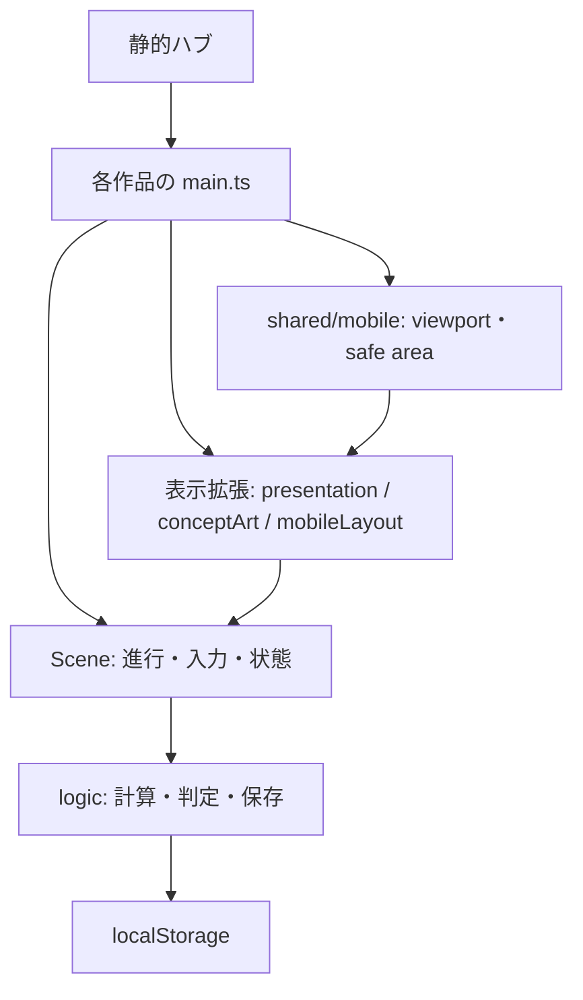

# 共通・配信基盤 — 実装設計書

初版確認: 2026-10-19 / c975eab。

## 配置と責務

- ルートindex.html: 静的ハブ。ルートはNodeプロジェクトではない。
- games/<id>: 独立したPhaser + TypeScript + Viteプロジェクト。package.json、lockfile、tsconfig、Playwright設定を持つ。
- src/main.ts: SDK初期化、表示拡張の組込、Scene登録、レスポンシブ基盤の接続。実行順は各作品の設計書を参照する。
- src/logic: Phaserから分離した計算・保存。描画から直接ルールを二重実装しない。
- presentation / conceptArt / mobileLayout等: Sceneのprototypeをラップする表示拡張が多い。元メソッドの呼出とdestroy/shutdown時の後始末を確認する。

## 共通モバイル基盤

[games/shared/mobile](../../games/shared/mobile) はviewport、safe area、touch、resize lifecycleを扱う。
[responsiveScene.ts](../../games/shared/mobile/responsiveScene.ts) はmobile-layoutイベントとmobileViewportLayoutレジストリを介して通知する。
ゲームの状態は作品側、Canvasサイズと表示領域は共通基盤が担当する。resizeでゲーム開始や報酬付与を再実行しない。
[localTelemetry](../../games/shared/localTelemetry.ts) の組込先はmain.ts。ai_project002_local_telemetry_v1:<gameId>へセッション数・初回操作数・活動時間・時刻をlocalStorageだけに保存する。localStorageを既定引数で評価せず、load/saveのtry内で取得する。読み取り失敗は空の記録、書き込み失敗は破棄として扱い、任意の利用記録が起動や入力を中断しない。保存形式と収集項目は変更しない。このモジュールにネットワーク送信はない。収集項目・保存・送信の変更は仕様への影響をレビューする。

## ビルド・テスト

対象ゲーム内で npm ci → npm run lint → npm run typecheck → npm test → npm run build。
画面変更は npx playwright test と必要な --browser=webkit を実施し、実スクショを見る。ブラウザ追加インストールは実行環境の規則に従う。
[Browser E2E](../../.github/workflows/e2e.yml)、[WebKit](../../.github/workflows/webkit.yml)、[Portal readiness](../../.github/workflows/crazygames-readiness.yml) は別の検査。
Karma QuestのWebKit抽出は既存のスモーク条件に加えてPlaywrightの@webkit-regressionタグを含む。新しいWebKit回帰テストはこのタグで追加し、--listと同じ抽出条件で対象と実行結果を確認する。タイトル変更だけで検査対象から外れないようにする。workflowの起動条件はmain宛PR・mainへのpush・手動実行であり、積み重ねPRの全てで自動実行されるわけではない。
画像基準更新は意図した差分を目視し、OS別画像と根拠を残す。単純な更新コマンド成功は品質確認の代わりではない。

## 文書同期の構成

[docs-policy.json](../docs-policy.json) が対象領域と仕様・設計の対応を持つ。
[check_docs.py](../../scripts/check_docs.py) はGitのbaseとheadを比較し、追加された変更記録を読み、更新宣言と文書差分を検査する。
[Documentation workflow](../../.github/workflows/docs.yml) はPRのbase/head SHAをイベントJSONから読み取り、merge-base以降を検査。secretや書込権限を必要としない。
更新不要には理由が必要。CIは意味の正しさを保証できないため、レビューで動作・設計との整合を確認する。
GitHubの必須チェック指定は管理者設定であり、このリポジトリへの追加だけでは設定済みにならない。

## 関連文書

[共通仕様](platform-spec.md) / [更新手順](../documentation-workflow.md)
