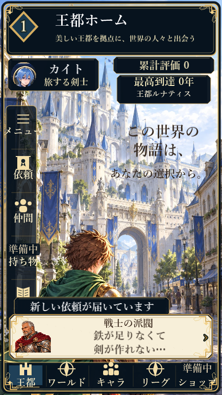
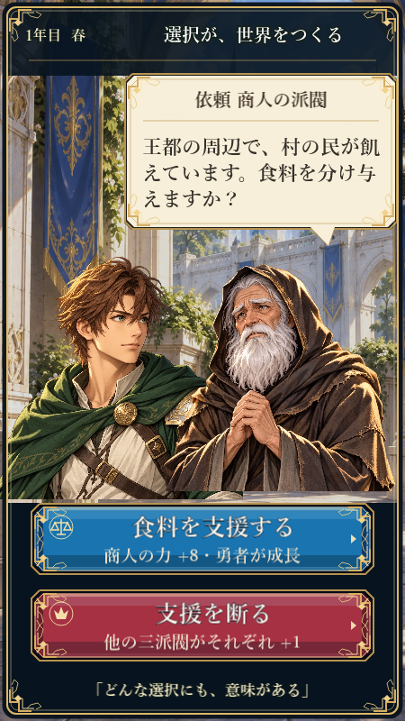
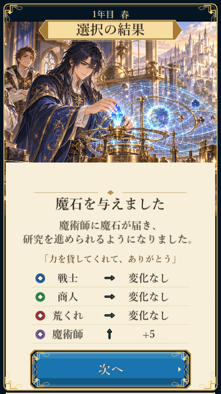
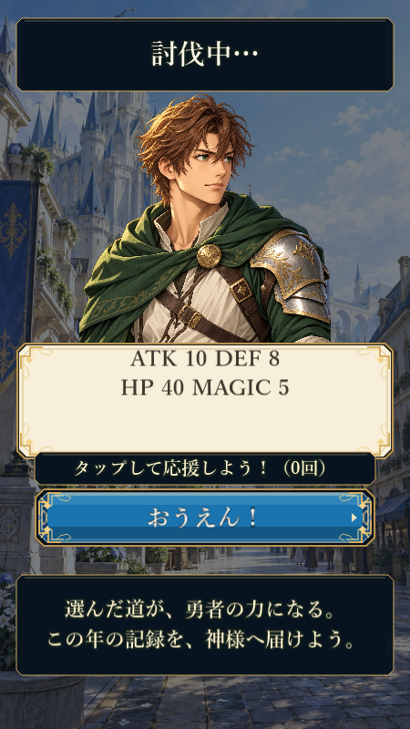
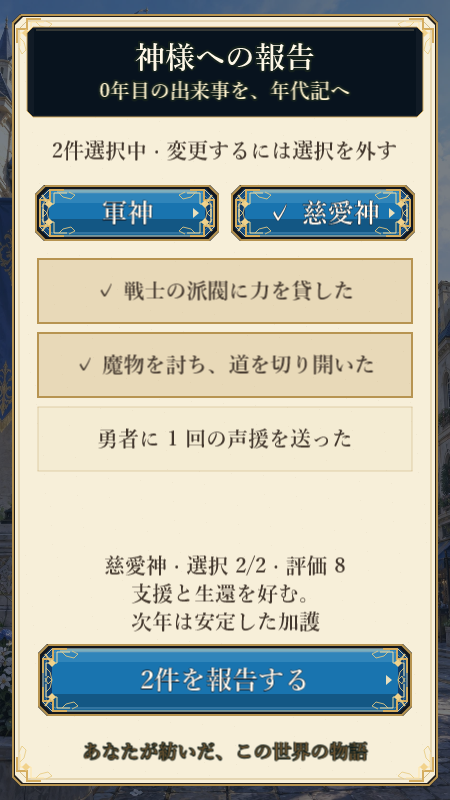
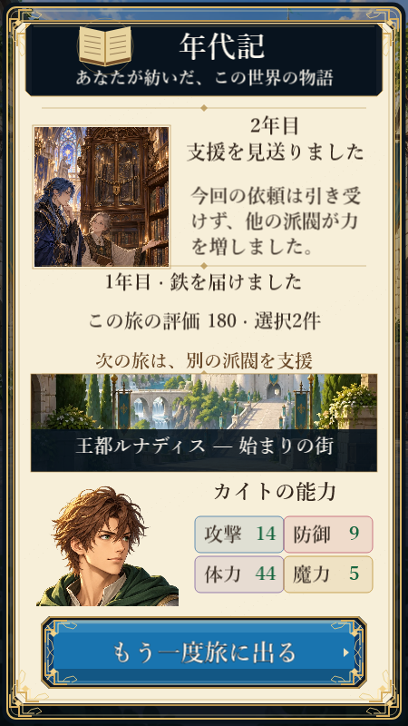
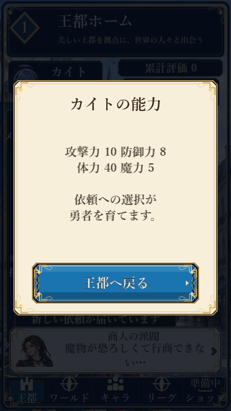
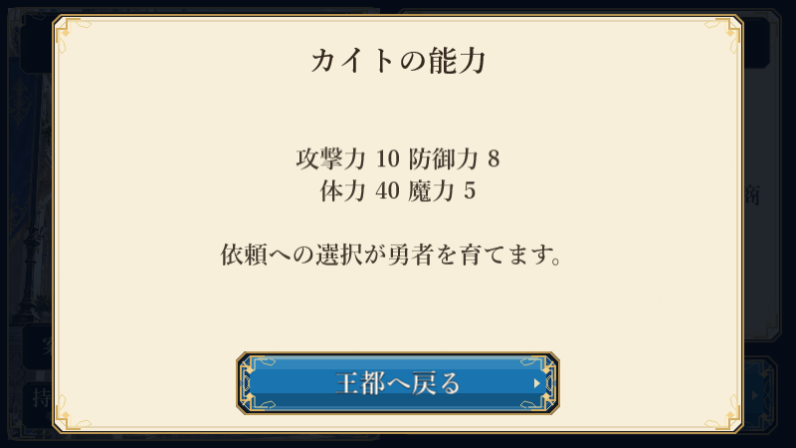

# Karma Quest 画面・入力レビュー — 2026-10-21

対象: PR #386後のローカル実装と今回のナビ入力修正。WebKitで新規取得した画面を目視し、既存画像比較と操作テストを併用した。6作品全体や実機の監査ではない。

## 画面順の確認

1. **王都ホーム：入力を修正。** 主要な進行情報と依頼カードを確認。ナビだけが押下直後に開くため、ドラッグや中断でキャンセルできなかった。縦10・横8項目を指離し確定へ統一。準備中表示の背後のアイコンを取り除き、依頼文末の記号だけの折返しも意味の切れ目で改行して修正。主要CTAの重なり・操作不能は今回の画像では見つからない。
   
2. **依頼：確認範囲では良好。** 人物・依頼文・青赤の返答CTAを分離。返答の効果もボタン内で読める。
   
3. **世界の反応：確認範囲では良好。** 年・結果・派閥変化・次へを識別でき、見出しはイラストに埋もれない。
   
4. **討伐：確認範囲では操作可能。** 勇者・能力値・声援CTAを識別。結果待ち中の画面で、戦闘全瞬間や演出品質の完全評価ではない。
   
5. **報告：確認範囲では良好。** 選択印、最大2件の案内、評価、送信を分離。画像比較用に状態を直接設定したため、この画像の0年は通常進行の証拠ではない。年の実表示は既存の年別テストで別途検査する。
   
6. **年代記：確認範囲では良好。** 評価・短いヒント・再出発CTAが枠内に収まり、今回の比較は基準変更なしで成功。
   

## 入力修正の確認

縦横18項目について押下時には遷移しないこと、別の指で確定しないこと、領域外で解除することを検査。代表ナビでリサイズ・blur・hiddenの解除、実マウスのドラッグアウト、タッチによる情報表示と閉じる操作をChromium/WebKitで確認した。

## 限界と残項目

- 画像比較の基準は既存の実装画面であり、原案モックとの完全一致を保証しない。
- 物理iOS Safari / Android Chrome、外部Portalは未確認。RCの公開判定は保留。
- スクリーンリーダー、キーボードのみの操作、OS文字拡大への対応をスクリーンショットから認定しない。
- 全画面・全作品の「改善点ゼロ」とは判定しない。新機能や演出全面刷新は今回のRC修正に混ぜない。

## 最終検証

lint・typecheck・build成功、単体123件成功。Windows Chromium全68件成功（Canvas専用1件スキップ）、WebKit回帰36件成功。Linux最終[Browser E2E](https://github.com/b-w-hiroki/AI_project002/actions/runs/39452141365)も68件成功・1件スキップ、全6作品のchecks/E2E成功。ホーム基準画像はOS別の実画面で更新し、比較許容差は維持。途中で既存の討伐テストの短い待機を検出し、ゲーム挙動は維持したまま結果をフレーム内で捕捉する検証へ変更。Chromium/WebKit各5並列の反復でも成功した。
